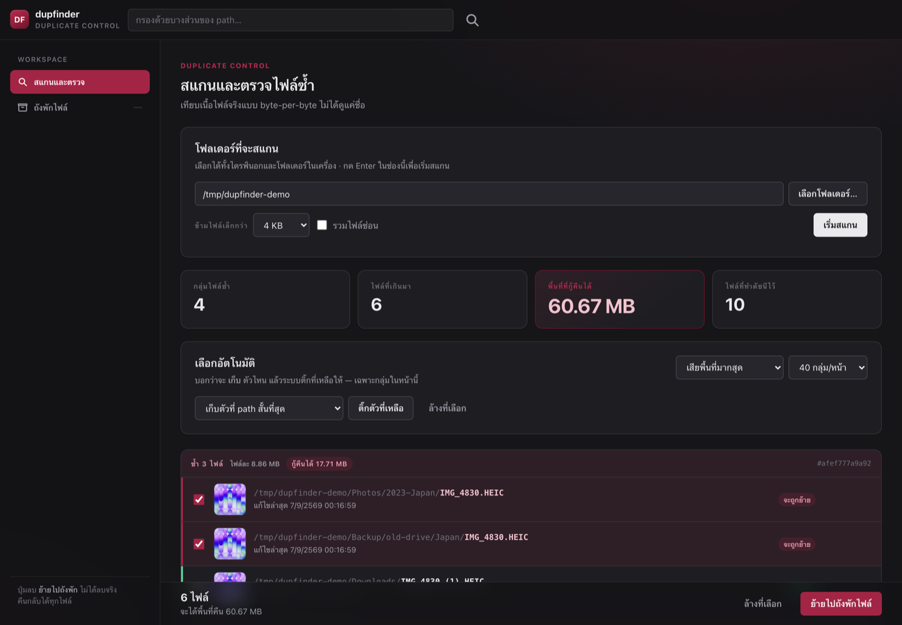
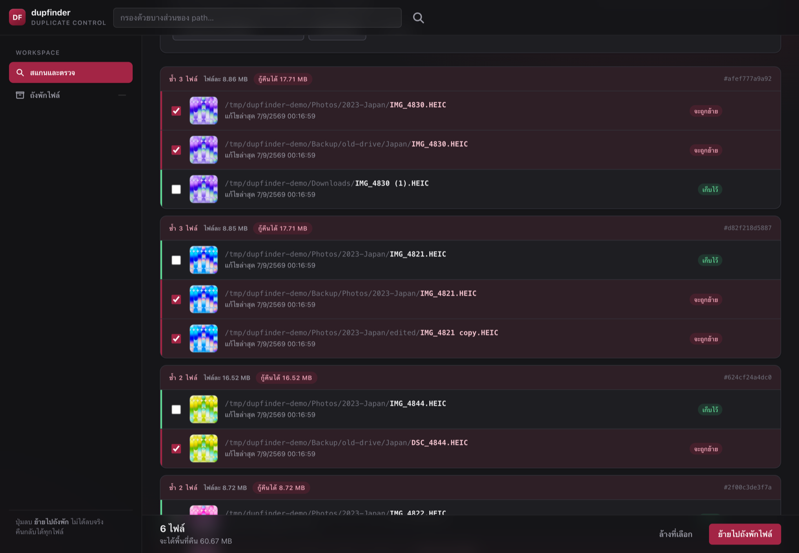
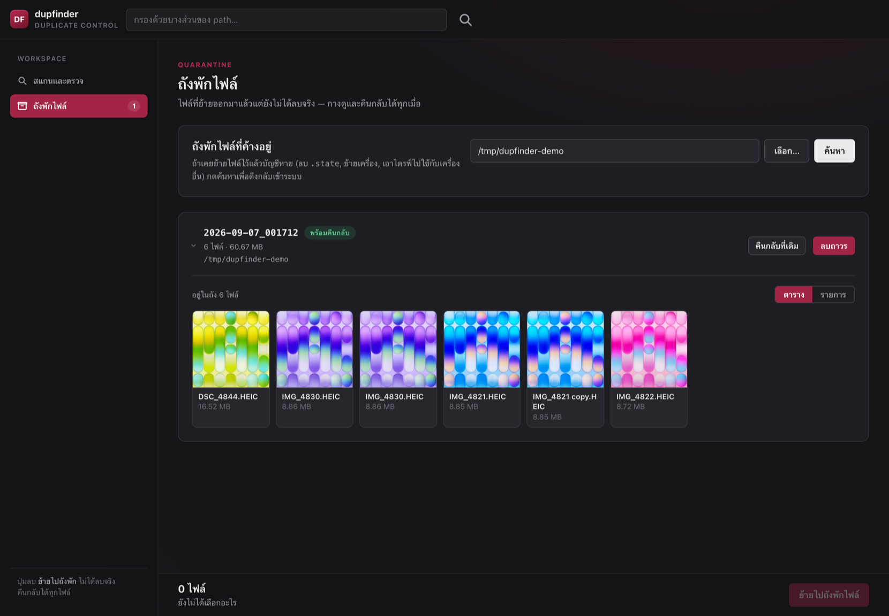
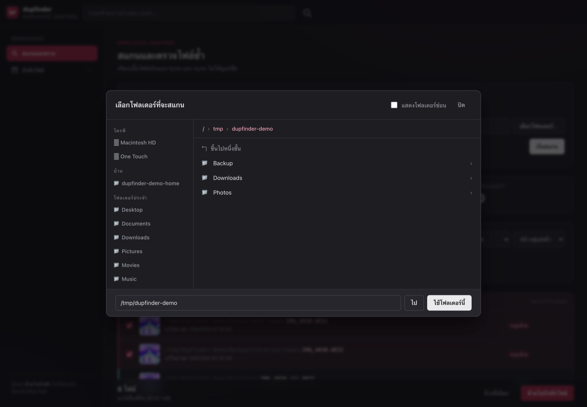

# dupfinder

หาไฟล์ที่ **เนื้อไฟล์ซ้ำกันเป๊ะ** (ไม่ดูชื่อ) แล้วรีวิว/ลบผ่านหน้าเว็บในเครื่อง
ใช้ Python stdlib ล้วน ไม่ต้อง `pip install` อะไรเลย

ปุ่มลบไม่ได้เรียก `rm` — ย้ายไปถังพักไฟล์บนไดรฟ์เดียวกัน และกดคืนกลับได้ทุกไฟล์

[English →](README.md)



## ภาพหน้าจอ

กลุ่มไฟล์ซ้ำ พร้อมป้ายบอกผลลัพธ์ของแต่ละกลุ่มก่อนกดจริง —
ตัวที่ติ๊กขึ้น **"จะถูกย้าย"** ตัวที่เหลือขึ้น **"เก็บไว้"**



ถังพักไฟล์ — ของที่ลบไปยังอยู่ครบ กางดูรูปได้ คืนกลับได้ทีละไฟล์หรือทั้งชุด



เลือกโฟลเดอร์ไหนในเครื่องก็ได้โดยไม่ต้องพิมพ์ path — ไดรฟ์ที่ต่ออยู่และโฟลเดอร์ประจำอยู่ในคลิกเดียว



## วิธีใช้

```bash
python3 dupfinder.py
```

เปิดเบราว์เซอร์ให้อัตโนมัติที่ http://127.0.0.1:8777
```
--port 9000        เปลี่ยนพอร์ต
--root ~/Pictures  ตั้งโฟลเดอร์เริ่มต้นในช่องสแกน (ค่าเริ่มต้น: โฟลเดอร์บ้าน)
--no-open          ไม่ต้องเปิดเบราว์เซอร์ให้ (ใช้ตอนรันผ่าน SSH)
```

ต้องการ Python 3.7 ขึ้นไป ไม่ต้องลง dependency อะไรเลย

หน้าเว็บเป็นภาษาไทยทั้งหมด ยกเว้นศัพท์ที่ปกติใช้อังกฤษอยู่แล้ว (path, hash, Finder, หน่วย KB/MB/GB)

## หน้าตา — Burgundy Ops

โทน **burgundy + เทาเข้ม** วางบนโครง shell + workspace

- **เทาเข้มไล่ระดับ** — พื้น `#161619` · การ์ด `#1e1e22` · input `#26262c` · hover `#2f2f36`
  ไม่ใช้ดำสนิทเลย เพื่อให้ยังแยกชั้นออกจากกันได้ในที่มืด
- **Shell กระจกฝ้า** `rgba(17,17,20,.74)` + blur 14px — header 64px, sidebar 256px
- **Burgundy `#a32545`** สงวนไว้ให้ของที่สำคัญจริง: เมนู active, ปุ่มที่ย้อนยาก,
  หัวกลุ่มไฟล์ซ้ำ, แถบ progress, focus ring
- **ปุ่มหลักเป็นสีสว่าง ไม่ใช่ burgundy** — เพราะถ้าปุ่ม "เริ่มสแกน" กับ "ลบถาวร"
  สีเดียวกัน มันจะกดผิดได้ ตอนนี้: สว่าง = ปลอดภัย, burgundy = ต้องคิดก่อนกด
- **Badge** ลดความสดลงให้เข้ากับพื้นมืด (เขียว/เหลือง/เทา/ฟ้า/ชมพูอมม่วง)

### จุดที่ปรับให้ใช้ง่ายขึ้น

- **ป้าย "จะถูกย้าย" / "เก็บไว้"** โผล่ในแต่ละกลุ่มทันทีที่ติ๊ก พร้อมแถบสีข้างซ้าย
  (burgundy = ย้ายออก, เขียว = เหลือไว้) เห็นผลลัพธ์ทั้งกลุ่มโดยไม่ต้องไล่อ่านทีละบรรทัด
- **การ์ดสแกนแยกเป็น 2 แถว** — path เต็มบรรทัดบน ตัวเลือกกับปุ่มอยู่บรรทัดล่าง
  ไม่อัดกันจนหาปุ่มไม่เจอ · กด Enter ในช่อง path เริ่มสแกนได้เลย
- **Toast แทน `alert()`** — ผลลัพธ์เด้งมุมขวาล่างแล้วหายเอง ไม่ต้องกด OK ทุกครั้ง
- **การ์ด "พื้นที่ที่กู้คืนได้" เป็นตัวเด่น** ขอบ burgundy + ตัวเลขใหญ่กว่าใบอื่น
- **Empty state บอกสาเหตุ** — แยกระหว่าง "ยังไม่ได้สแกน", "ตัวกรองไม่ตรง", "ไม่มีไฟล์ซ้ำจริงๆ"
- **Skeleton ระหว่างโหลด** แทนหน้าว่างเปล่า
- **ปุ่ม Finder โผล่ตอน hover** ลดความรกของแถวรายการ (ยัง tab เข้าถึงได้)
- **ปุ่ม "ล้างที่เลือก" ในแถบล่าง** ไม่ต้องเลื่อนขึ้นไปข้างบน
- **ตัวนับชุดในถังพัก** แสดงบน sidebar
- **% ความคืบหน้า** ตอนสแกน
- ช่องกรองเป็น `type=search` มีปุ่มล้างของเบราว์เซอร์ให้

## เลือกโฟลเดอร์

กดปุ่ม **เลือกโฟลเดอร์…** เพื่อเปิดตัวไล่ดูโฟลเดอร์ในเครื่อง — เลือกได้ทั้งไดรฟ์นอก
และโฟลเดอร์ในเครื่องตัวเอง ไม่ต้องพิมพ์ path เอง

- แถบซ้ายเป็นทางลัด: ไดรฟ์ที่ต่ออยู่ทั้งหมด, บ้าน, Desktop/Documents/Downloads/Pictures/Movies/Music
- กดชื่อโฟลเดอร์เพื่อเข้าไปข้างใน, กด breadcrumb ด้านบนเพื่อย้อนกลับ
- โฟลเดอร์ที่ตัวสแกนข้ามให้อยู่แล้ว (`$RECYCLE.BIN`, `System Volume Information` ฯลฯ) จะโชว์จางๆ
- ยังพิมพ์ path ตรงๆ ในช่องล่างแล้วกด **ไป** ได้เหมือนเดิม
- ปุ่มเดียวกันนี้ใช้เลือกโฟลเดอร์ให้กฎ *“ตัวที่อยู่ในโฟลเดอร์ที่กำหนด”* ได้ด้วย

การเลือกโฟลเดอร์ที่ต้องขอสิทธิ์ macOS (เช่น `~/Library/Mail`) จะขึ้นข้อความบอกว่า
ต้องให้ Full Disk Access กับ Terminal ก่อน

## ทำงานยังไง

สแกน 3 ชั้น เพื่อไม่ต้อง hash ทุกไฟล์:

1. **จัดกลุ่มตามขนาด** — ไฟล์ที่ขนาดไม่ซ้ำใครตัดทิ้งทันที (ตัดออกได้เกิน 90%)
2. **hash 64KB แรก** ของไฟล์ที่ขนาดชนกัน
3. **hash เต็มไฟล์** (BLAKE2b) เฉพาะที่ยังรอด → ยืนยันว่าซ้ำจริง byte-per-byte

ผลลัพธ์เก็บใน SQLite พร้อม cache ตาม `path + size + mtime`
→ สแกนรอบสองเร็วมาก, ถอดสายกลางทางแล้วต่อได้

## แคช

หน้าเว็บส่งด้วย `Cache-Control: no-store` เสมอ — ถ้าปล่อยให้แคช เบราว์เซอร์จะค้างอยู่กับ
UI เวอร์ชันเก่าที่ยิง payload คนละแบบกับเซิร์ฟเวอร์ใหม่ (เคยทำให้ปุ่มลบถาวรเงียบสนิท:
ตอบว่าสำเร็จแต่ไม่ได้ลบอะไร) ส่วน thumbnail กับไฟล์ยังแคช 1 ชั่วโมงตามเดิม

คำสั่งคืน/ลบถาวรที่หาชุดในบัญชีไม่เจอ จะ **ฟ้องเป็น error** ไม่ตอบว่าสำเร็จ
และถ้าไม่ได้ส่ง root มาแต่ชื่อชุดไม่กำกวม ระบบจะเติม root ให้เอง

## ที่เก็บข้อมูล — แยกกันคนละไฟล์โดยตั้งใจ

```
.state/index.db    ดัชนีการสแกน — ทิ้งได้ สร้างใหม่ได้เสมอ
.state/ledger.db   บัญชีถังพักไฟล์ — ของมีค่า ห้ามลบ
.state/thumbs/     แคช thumbnail — ทิ้งได้
```

`ledger.db` คือแผนที่ว่าไฟล์ไหนถูกย้ายมาจากไหน ถ้าหายไปแล้วยังไม่ได้ดึงกลับ
ไฟล์ในถังพักจะกลายเป็นกำพร้าทันที (ยังอยู่ครบ แต่ระบบไม่รู้จัก)
เวลาจะล้าง state ให้ลบแค่ `index.db` พอ

**และเผื่อ `ledger.db` หายจริงๆ** ทุกชุดในถังพักมี `manifest.json` ของตัวเองอยู่ข้างใน
เดินทางไปพร้อมไฟล์เสมอ — ย้ายเครื่อง ก็อปไดรฟ์ หรือลบ `.state` ทิ้งก็ยังกู้ได้

## สิ่งที่ข้ามให้อัตโนมัติ

- `._xxx` (AppleDouble), `.DS_Store`, `Thumbs.db`, `desktop.ini`
- `$RECYCLE.BIN`, `System Volume Information`, `.Spotlight-V100`, `.Trashes`, `.fseventsd`
- ไฟล์ 0 byte และไฟล์เล็กกว่า min size ที่ตั้งไว้
- symlink
- **hardlink** — ไฟล์ที่ชี้ inode เดียวกันคือไฟล์เดียวกันทางกายภาพ ไม่นับเป็นซ้ำ

## ความปลอดภัย

- **ไม่มีการ `rm` ใดๆ** ปุ่มลบคือการ *ย้าย* ไปที่ `<root>/_DUPFINDER_QUARANTINE/<วันเวลา>/`
  โดยคงโครงสร้างโฟลเดอร์เดิมไว้ (ย้ายในไดรฟ์เดียวกัน = แค่ขยับ metadata เร็วมาก)
- กด **คืนกลับที่เดิม** ในแท็บถังพักไฟล์ เพื่อย้ายกลับได้ทั้งชุด หรือทีละไฟล์ก็ได้
- ลบถาวรจริงๆ ต้องกด **Delete permanently** ในแท็บ Quarantine อีกที
- เซิร์ฟเวอร์ปฏิเสธคำขอที่จะทำให้กลุ่มใดกลุ่มหนึ่ง **ไม่เหลือไฟล์เลย** เสมอ
- แต่ละชุดในถังพัก **ผูกกับ root ที่มันมาจริงๆ** ไม่ใช่ root ที่กำลังสแกนอยู่
  → สลับไปสแกนไดรฟ์อื่นแล้วกดลบถาวร มันจะยังลบถูกที่
- ถ้าหาโฟลเดอร์จริงไม่เจอ (ไดรฟ์ไม่ได้เสียบ) **ลบถาวรจะไม่ทำงาน** และไม่ลบบัญชีทิ้ง
  ป้องกันไฟล์กลายเป็นกำพร้า
- อ่าน *เนื้อไฟล์* ได้เฉพาะ path ที่อยู่ใน index เท่านั้น (กัน path traversal)
- เซิร์ฟเวอร์ bind แค่ `127.0.0.1` เครื่องอื่นในเน็ตเวิร์กเข้าไม่ได้
- ตัวไล่ดูโฟลเดอร์อ่านได้แค่ *รายชื่อโฟลเดอร์* เท่านั้น ไม่อ่านเนื้อไฟล์ และเห็นเท่าที่
  สิทธิ์ของ user ที่รันเห็น

## กฎเลือกอัตโนมัติ (Auto-select)

เลือกว่าจะ *เก็บ* ตัวไหน แล้วระบบติ๊กที่เหลือให้:

- **oldest / newest copy** — เก็บตัวที่เก่า/ใหม่ที่สุด
- **shortest path** — เก็บตัวที่ path สั้นที่สุด (มักจะเป็นตัวต้นฉบับ)
- **the one inside a folder…** — ใส่ path ของโฟลเดอร์ที่ไว้ใจ
  แล้วจะเก็บตัวที่อยู่ในโฟลเดอร์นั้น ติ๊กตัวนอกโฟลเดอร์ทิ้ง
  ถ้ากลุ่มไหนอยู่ในโฟลเดอร์นั้นทั้งหมด หรือไม่มีเลย → **ข้าม ไม่ติ๊กอะไร** (กันพลาด)

เลือกอัตโนมัติทำเฉพาะกลุ่มที่แสดงอยู่ในหน้าปัจจุบัน เพื่อบังคับให้ได้ดูก่อนลบ

## กู้ถังพักไฟล์ที่ค้างอยู่

ในแท็บถังพักไฟล์มีกล่อง **“ถังพักไฟล์ที่ค้างอยู่”** — เลือกโฟลเดอร์แล้วกด **ค้นหา**
มันจะไล่หา `_DUPFINDER_QUARANTINE` (ลึกไม่เกิน 6 ชั้น) แล้วบอกว่าชุดไหนระบบยังไม่รู้จัก
กด **ดึงกลับเข้าระบบ** เพื่อเอาเข้าบัญชี แล้วคืนไฟล์กลับที่เดิมได้ตามปกติ

ใช้ `manifest.json` ถ้ามี ถ้าไม่มี (ถังที่สร้างจากเวอร์ชันเก่า) ก็ยังกู้ได้
เพราะโครงสร้างโฟลเดอร์ในถังพักสะท้อน path เดิมอยู่แล้ว

## แท็บถังพักไฟล์

กดที่หัวข้อชุดเพื่อ **กางดูไฟล์ข้างใน** โดยไม่ต้องเปิด Finder — มี 2 มุมมอง:

- **ตาราง** — เรียง thumbnail เป็นกริด เห็นภาพรวมว่ามีอะไรกองอยู่บ้าง (ค่าเริ่มต้น)
- **รายการ** — เห็น path เต็มที่ไฟล์ถูกย้ายมาจาก พร้อมปุ่ม **คืนกลับ** ทีละไฟล์

กดที่รูปเพื่อเปิดไฟล์เต็ม โหลด thumbnail เฉพาะที่เลื่อนถึง และแสดงทีละ 60 ไฟล์
(กด “ดูเพิ่ม” เพื่อโหลดต่อ) ไฟล์ที่คืนกลับไปแล้วจะหายจากรายการเอง

## Thumbnail

**macOS** ใช้ `qlmanage` (QuickLook) — รองรับ HEIC, MOV, RAW, PDF โดยไม่ต้องลงอะไรเพิ่ม
**Linux/Windows** ใช้ Pillow ถ้าเครื่องมีติดตั้งอยู่ (`pip install pillow`) รองรับเฉพาะรูปทั่วไป

Thumbnail เป็นของเสริมล้วนๆ ไม่มีก็ใช้โปรแกรมได้ครบ แค่โชว์เป็นป้ายนามสกุลแทน
แคชไว้ที่ `.state/thumbs/`
กดที่รูปเพื่อเปิดไฟล์เต็ม, ปุ่ม `Finder ↗` เพื่อเปิดตำแหน่งใน Finder

## รองรับแพลตฟอร์มไหนบ้าง

| | สถานะ |
|---|---|
| **macOS** | พัฒนาและทดสอบบนนี้ thumbnail มาจาก QuickLook ไม่ต้องลงอะไรเพิ่ม |
| **Linux** | น่าจะใช้ได้ · thumbnail ต้องมี Pillow · เปิดโฟลเดอร์ใช้ `xdg-open` |
| **Windows** | ยังไม่มีใครทดสอบ · จัดการ path แบบพกพาได้และตรวจ drive letter แล้ว แต่ยังไม่ได้ลองจริง |

## ข้อจำกัด

- **หาซ้ำแบบเป๊ะเท่านั้น** — รูปที่ถูกย่อ/บีบอัด/แปลงจาก HEIC เป็น JPG ถือเป็นคนละไฟล์
  ยังไม่รองรับการหารูปที่ "คล้ายกัน" (perceptual hash)
- เลือกอัตโนมัติทำทีละหน้า ตามที่ตั้งใจออกแบบไว้
- ไม่ได้ออกแบบให้เปิดออกเน็ตเวิร์ก เป็นเครื่องมือใช้คนเดียวในเครื่อง ไม่มีระบบล็อกอิน

## License

MIT — ดู [LICENSE](LICENSE)
